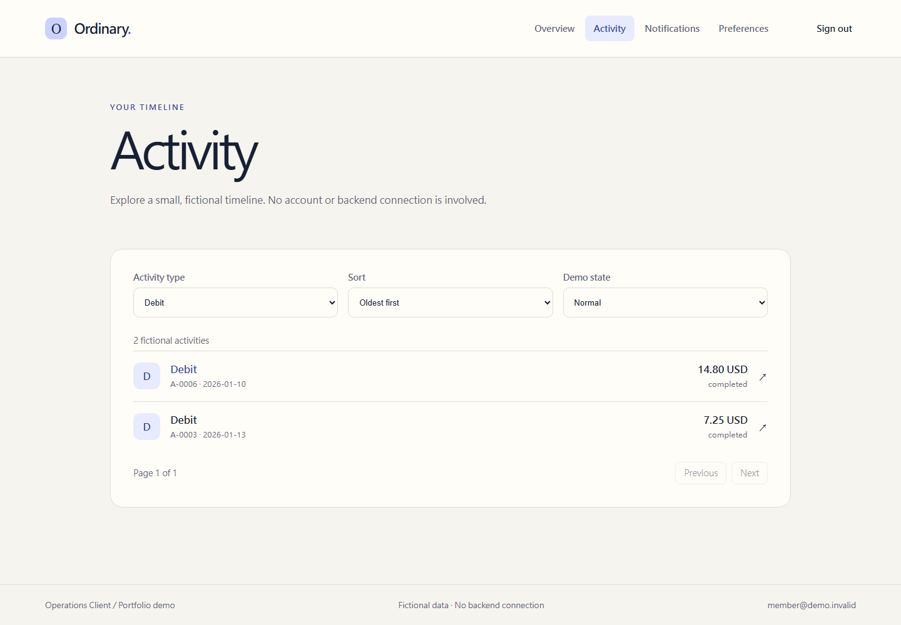
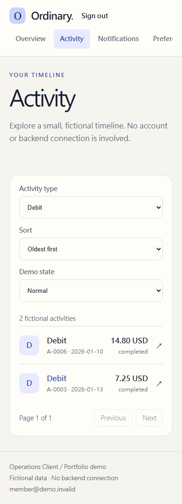
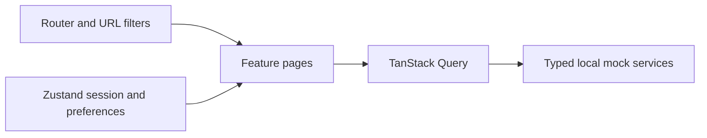

# React Operations Client

A public React portfolio project for a focused client experience. It is a clean-room implementation that uses only locally authored mock data.

Current status: account overview, activity list/detail, and notifications use an independent local mock API with URL-backed filters, sorting, pagination, and loading/error/empty states. Demo sign-in, protected navigation, and persistent display preferences are also available. See [Product spec](docs/PRODUCT_SPEC.md).

## Implemented scope

- Account overview and activity history
- Mock notifications and preferences
- Responsive navigation and accessible interface states
- Mock session handling

## Local development

```bash
npm ci
npm run dev
```

Open the local URL shown by Vite. Use `member@demo.invalid` with passcode `demo123`. These are public demo strings, not real credentials. The session is stored only in browser session storage.

In Activity, filter and sort fictional records, change pages, and open a detail. Overview and Notifications also include independent fictional data. The “Demo state” controls show normal, empty, and service-error responses. No real network request is sent by the mock service.

Preferences offers light/dark appearance and comfortable/compact list spacing, stored only in this browser. Returning from a filtered activity detail preserves the URL filters. No real network request is sent by the mock service.

The light palette follows Manager's navy, blue and warm-neutral color tokens while retaining Client's layout.

## Quality checks

Unexpected route/render failures show a safe recovery screen instead of a blank page. The demo does not expose internal error details or send them to an external service.

```bash
npm run typecheck
npm run lint
npm run format:check
npm run test
npm run build
```

## Browser verification

Local verification (2026-10-09): 32 Vitest tests and 6 Chromium E2E cases passed.
The browser cases cover three journeys at two viewport sizes; they are not six distinct workflows.
Type checking, lint, formatting and production build also passed.

Use Node.js 22.14 or newer in the Node 22 line. Install Chromium once, then run:

```bash
npx playwright install chromium
npm run test:e2e
```

The script builds the production bundle; Playwright setup starts and closes an in-process preview server on port 4174.
Three journeys run at desktop (1440 × 1000) and mobile (390 × 844) sizes.
Each test gets a fresh browser context. Vitest only collects tests under `src/`.
Failure traces and the HTML report stay in ignored `test-results/` and `playwright-report/` directories.
The GitHub workflow runs unit/component checks and Chromium journeys; remote CI status must be checked after pushing.

## Preview





These screenshots use fictional data. Regenerate them from the protected activity browser journey (`activity.png`) after UI changes.

## Architecture and decisions



- The URL owns list filters, sorting and pagination. Details preserve the originating list query through router history state.
- TanStack Query owns request data and cache; Zustand owns browser session and display preferences. Query results are not copied into Zustand.
- Mock reads accept `AbortSignal`; cleanup cancels pending timers. Retry policy distinguishes retryable service errors from missing records.
- Display preferences persist in local storage; the mock login session lives in session storage. Browser tests verify persistence through reload.
- Out-of-range pages are corrected without removing filters. Unexpected rendering failures expose recovery controls.

## Two-minute walkthrough

1. Sign in to Overview and inspect the fictional account summary.
2. Open Activity, filter the timeline, open a detail and return. Switch Demo state between normal, empty and error.
3. Choose Dark and Compact in Preferences, reload, and verify the choices persist.

## Limits and next steps

This is a frontend demonstration. Route guards are not server authorization, and mock data is not shared between repositories.
Notifications are read-only; marking them read is not implemented.
No live connection, token refresh, performance benchmark, or public deployment is claimed.
Mobile verification uses a Chromium viewport, not a physical device or Safari.
Static hosting must rewrite application routes to `index.html` so direct links and refreshes work.
The local preview is available with `npm run build` followed by `npm run preview`.

No real API, account, transaction, or personal data is used or accepted by this project.
