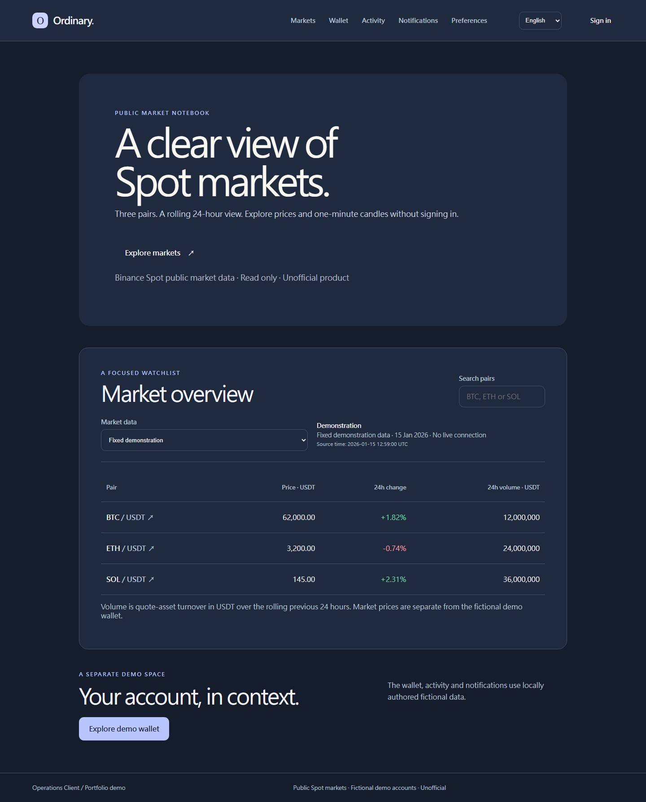
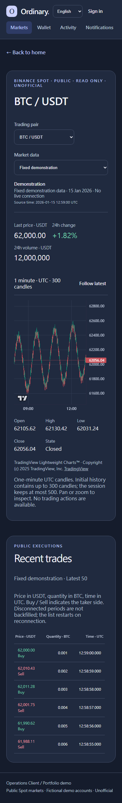
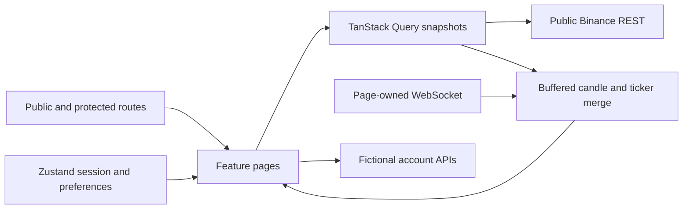

# React Operations Client

A React + TypeScript portfolio app with a public Spot market notebook and a separate fictional account experience. Market data comes from keyless Binance endpoints; wallet, activity, notifications and authentication remain local mocks. This is an unofficial, read-only product.

## Explore

[Live demo](https://react-operations-client.vercel.app/) · [Fixed market demonstration](https://react-operations-client.vercel.app/?mode=demo)

Deployed on Vercel. Public markets open without sign-in; account pages use the fictional demo account below. Deployment is available; production market connectivity and remote CI results have not been verified in this documentation.

- Public `/`: searchable BTC/USDT, ETH/USDT and SOL/USDT watchlist with price, rolling 24h change and USDT quote volume.
- Public `/markets/:symbol`: 24h summary, interactive one-minute UTC candles and recent executions, connection state and recovery.
- Shared demo sign-in dialog: stays on the current public page or returns to the requested protected URL. Cancel clears the destination; reload and browser history preserve dialog state.
- Protected `/wallet/overview`, `/activity`, `/activity/:activityId`, `/notifications`, `/preferences`: fictional balance/records, URL filters/pagination, persistent light/dark theme and list density.
- Removed `/overview` and `/sign-in` return 404.

## Run locally

Use Node.js 22.14 or newer in the Node 22 line.

```bash
npm ci
npm run dev
```

Home opens without authentication. Choose **Fixed demonstration** in Market data, or open `/?mode=demo`, to explore locally authored fixed fixtures without external connectivity. This is explicit, never a silent fallback for live data. Live requires browser access to `data-api.binance.vision` and `data-stream.binance.vision`.

Demo account: `member@demo.invalid`, passcode `demo123`. These are public fictional strings. Session lives in session storage; preferences in local storage. The dialog does not connect a Binance account.

## Preview





These screenshots use explicit fixed demonstration mode. [Real connection evidence](docs/market-smoke.json) and the [live smoke screenshot](docs/screenshots/market-live-smoke.png) are separate dated artifacts.

Regenerate the fixed market screenshots with `npm run screenshots:markets` after UI changes.

## Architecture



- Feature directories own UI, hooks, services, types and tests. No runtime imports from Manager.
- Query owns metadata and REST snapshots. One market API instance coordinates rate-limit cooldown; Query does not multiply retries. Requests cancel with their page/connection attempt.
- Each mounted market page owns one socket per visible tab. Background/offline closes it; foreground, reconnect and candle gaps resynchronize history before live.
- Events buffer while REST loads, with generation checks for late results. Candles merge by open time/event time and never reopen after closure. Limits: 300 initial candles, 500 retained, 1,000 buffered events.
- Ticker and candle streams must be fresh before live. A 15s stale threshold and bounded jittered reconnect protect recovery. Quiet trade streams do not imply a failed connection. WS failure retains a labelled stale snapshot. 429/418 honor Retry-After, including manual retry.
- Detail shares its socket with `@trade`: retain 50 executions, deduplicate IDs, order by execution time, and batch live publications every 250ms. Quantity is in the base asset; Buy/Sell is the taker side. Reconnection resets the list without backfilling disconnected periods.
- Live and fixture data stay separate. Invalid payloads fail rather than becoming zero prices. Metadata excludes non-Spot/inactive instruments.
- Charts support pan/zoom, Follow latest, themes and ResizeObserver cleanup. Lightweight Charts 5.2.1 uses Apache-2.0; creator/NOTICE attribution and TradingView link are displayed.
- URL owns mode/search and account filters. Query data is not mirrored into Zustand.

See [Market design](docs/MARKET_DESIGN.md) and [Product spec](docs/PRODUCT_SPEC.md). Selected legacy information hierarchy and interactions were reimplemented in React using the Client palette; no Vue source, styles, assets, private endpoints or account data were copied.

## Language and display preferences

English is the default. The header and Preferences offer English, Traditional Chinese (`zh-TW`), Simplified Chinese (`zh-CN`) and Arabic (`ar`). Language is saved locally; browser language does not override it. New users start in dark mode; existing light-mode preferences are preserved, and display reset returns to dark mode.

Arabic uses RTL layout while chart time, prices, symbols and account identifiers retain LTR order. Switching language preserves the URL, session and mounted chart. Market recovery messages and fictional account content are translated alongside navigation, forms and accessible labels.

`src/i18n/messages/` contains source dictionaries and documented English fallback exceptions. `scripts/build-locales.mjs` validates keys and interpolation, then generates complete dictionaries under `src/i18n/locales/`. Only the selected language chunk loads at runtime; English fallback is merged during build. A failed switch keeps the current language and preference. `npm run test:i18n` validates and regenerates the bundles.

## Verification

```bash
npm run typecheck
npm run lint
npm run format:check
npm run test
npm run build
npx playwright install chromium
npm run test:e2e
```

Local verification on 2026-10-12: 64 Vitest tests and 24 Chromium E2E cases (12 journeys × desktop/mobile viewports). E2E uses fixed intercepted REST/WS payloads, independent of Binance availability. Cases cover markets, candles, trades, recovery, account flows, saved light/dark preferences, on-demand language loading, translated account content, language-load failure and Arabic RTL switching without chart recreation. Mobile means a viewport, not a physical device or Safari.

Optional real-network smoke check, separate from CI:

```bash
npm run test:market-smoke
```

It builds and opens production preview on port 4175, connects to public data and saves a dated JSON report and screenshot. The local BTCUSDT check on 2026-10-11 reached live with metadata/ticker/candles HTTP 200, received trade events and had no page errors. This confirms that local environment at that time; deployment connectivity is not claimed.

## Limits

No keys, account integration, orders, order book, token refresh or official affiliation. Mock wallet data is unrelated to public prices. Notifications remain read-only. Remote CI results, production market connectivity, performance benchmarks, physical-device and Safari verification remain unconfirmed here. No leftward historical pagination; charts show bounded recent history. Visible tabs each own their connection without cross-tab leadership. Static hosting must rewrite app routes to `index.html`.
